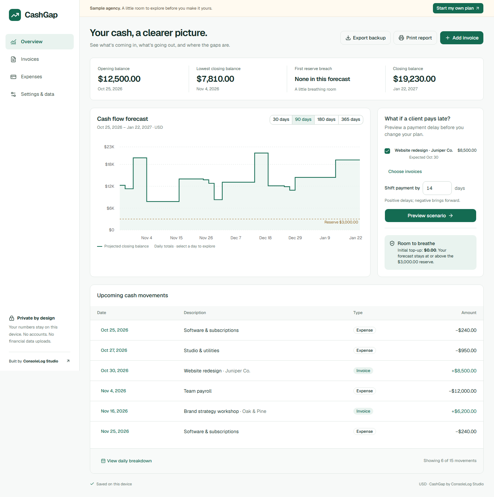

# CashGap

A private cash-flow planner for small agencies. See how expected client receipts, scheduled expenses, and payment delays affect your cash reserve.

**Self-initiated ConsoleLog Studio portfolio project. All sample companies and transactions are fictional.**

**[Live demo](https://cashgap.pages.dev)** · **[GitHub source](https://github.com/shawalkabirchy/cashgap)**



## Run locally

Use Node **24.14.0** and npm **11.14.1**. Dependency versions are recorded in `package-lock.json`.

```sh
npm ci
npm run dev
```

Development runs at `http://localhost:3000`. No environment variables, API keys, database service, or paid account are required.

For the production export:

```sh
npm run build
npm run preview
```

Open `http://localhost:4173`. The `out/` directory is the complete deployable static application. `next start` is not used for static exports.

## Verification

```sh
npm run lint
npm run build
npm run typecheck
npm test
npx playwright install chromium firefox webkit
npm run test:e2e
```

Build before browser tests so they exercise the current production export. Playwright starts the preview server if port 4173 is free, or reuses that server locally. Each test has an isolated browser workspace. The suite exercises Chromium, Firefox, and WebKit; WebKit testing is not a claim that physical Safari or iOS was tested.

See [acceptance evidence](docs/acceptance-results.md) for results, environment, limits, and commands actually run.

## What it does

- Tracks expected, received, and cancelled invoices, one-time expenses, and anchored monthly expense rules.
- Projects daily closing balances for 30, 90, 180, or 365 days and explains every contributing movement.
- Shows the lowest closing balance, first reserve breach, closing balance, danger days, and minimum initial top-up.
- Previews signed invoice date shifts without modifying saved records; Apply commits the selected changes once.
- Imports validated CSV files atomically, exports complete JSON backups, and restores backups after explicit replacement confirmation.
- Provides a responsive light dashboard, keyboard-operable forms, a daily table, and a browser print/Save PDF report.
- Starts a fresh browser workspace with a clearly labeled synthetic agency. Returning visitors keep their saved plan.

## Try the portfolio story

On Overview, keep **Website redesign · Juniper Co.** selected and the shift at **14** days. Choose **Preview scenario**. The projected minimum drops below the reserve and the required initial top-up appears. The dashed line shows the saved baseline. **Cancel preview** restores it; **Apply scenario** saves the changed expected date.

The sample starts on the browser's current local calendar date. For the fixture starting October 25, 2026, its 90-day baseline minimum is **$7,810.00**. Delaying the $8,500 Juniper payment by 14 days lowers that minimum to **−$690.00** and requires a **$3,690.00** initial top-up to maintain a $3,000 reserve. These are synthetic scenario results, not customer outcomes.

## Calculation policy

Opening balance is the balance **before** start-date transactions. Each day's closing balance is its opening balance plus receipts minus expenses. Same-day movements are combined; intraday order and bank-clearing times are not modeled.

Expected invoices contribute on their expected date. Received invoices contribute once on their actual date; actual dates cannot be in the future. Receipts before the forecast start are already included in opening balance. Cancelled invoices contribute nothing. Expected dates before the forecast start appear as overdue and unscheduled, and remain excluded until rescheduled. Records after the horizon remain stored.

Monthly expenses retain the day of their first payment. January 31 becomes February 28 or 29, then March 31. A rule's optional end date is exclusive. A danger day closes **strictly below** reserve. Initial top-up is `max(0, reserve − minimum projected closing balance)` and means cash added at the forecast's start.

Amounts are parsed exactly into integer minor units. USD and BDT use two decimal places; currencies are never converted or combined. The workspace currency is locked while financial records exist. Each entered amount is capped at 1,000,000,000 minor units, and opening balance may be negative down to that magnitude. Derived totals must remain safe integers.

## Storage, recovery, and privacy

CashGap uses one IndexedDB workspace in this browser and origin. The database is `cashgap`, schema version 1, object store `workspace`, key `current`. Its snapshot contains the workspace, sample marker, and a monotonically increasing revision. Save validates all changed data, compares the expected revision, and commits the snapshot and next revision in one transaction. Success appears only after the transaction completes.

Another tab's save cannot be silently overwritten. A conflict offers reload, copying unsaved text, and backup export. Blocked or full storage shows **Not saved**, preserves pending changes in memory, and offers recovery/export. If storage cannot open initially, an unsaved sample requires an explicit choice. A failed read or unsupported database version never clears existing storage.

**Export backup** exports the committed workspace; **Export unsaved changes** exports the pending recovery snapshot. Replacement confirmations always offer the currently committed workspace first. A failed write also enables a navigation warning while pending changes remain in memory.

Browser storage can be evicted or cleared. Export JSON regularly. Private browsing and storage restrictions can prevent saving. Data does not sync between devices, browsers, ports, domains, or preview deployments: `localhost:3000` and `localhost:4173` are different workspaces. Export/import is the transfer mechanism. Preserve a backup before changing the deployment origin.

There are no analytics, session replay, financial-data uploads, authentication, or bank APIs. Fonts and application dependencies are served with the app. Static navigation still needs the requested page to be available; this is not an installable offline PWA.

## Files and limits

One workspace supports **500 invoices**, **500 one-time expenses**, and **50 monthly rules**. Default horizon is **90 days**, default currency **USD**, and BDT is available when creating an empty plan.

CSV files are at most **1 MiB / 500 data rows**, with exactly these columns in order:

```csv
type,label,clientName,amount,date
invoice,Website discovery,Example Client,2500.00,2026-11-03
expense,Contractor deposit,,800.00,2026-11-05
```

Use `invoice` or `expense`, positive decimal amounts without commas/currency symbols, and real `YYYY-MM-DD` dates. Invoice client names may be absent; expense client names must be empty. Imported invoices are expected and expenses are one-time. Quoted commas, quotes, and newlines are supported. Exact normalized duplicates within the file or existing workspace are rejected. Any invalid row or exceeded final workspace limit prevents all writes. An example is in [files/cashgap-example.csv](files/cashgap-example.csv); the import dialog also generates an example relative to the current forecast start.

JSON backups are at most **10 MiB**, using:

```json
{
  "appId": "P05",
  "formatVersion": 1,
  "exportedAt": "2026-10-25T00:00:00.000Z",
  "payload": { "settings": {}, "invoices": [], "expenses": [] }
}
```

The abbreviated empty objects above illustrate the envelope, not a valid complete settings object. Exported payloads use the schemas in `src/lib/domain.ts`. Restore validates the app/version, timestamps, types, real dates, unique IDs, limits, statuses, and amounts before offering replacement. It never merges and never partially restores. Runtime revisions and the demo marker are excluded from backups; a restored backup is treated as a personal plan. Future backup/database migrations must preserve the old state if conversion fails.

## Architecture and dependencies

`src/lib/domain.ts` owns pure calculations, calendar rules, money, and validation. `storage.ts` owns transactions. `transfers.ts` owns file contracts. `sample.ts` owns synthetic fixtures. A single workspace provider connects these to the App Router's fixed Overview, Invoices, Expenses, and Settings routes. Charts load on demand; forms keep their drafts locally.

Next.js 16.4.3 / React 19.3.1, TypeScript 6.0.3, Tailwind 4.3.3, official shadcn components, Recharts, idb, Zod, Papa Parse, and locally bundled Geist are pinned in the lockfile. Vitest covers the domain and imports; Playwright plus axe-core covers the exported app.

Builds use Next.js's supported **Webpack** option because the default Turbopack CSS worker failed reproducibly on this Windows environment. TypeScript 6 and ESLint 9 match the current Next lint-plugin compatibility ranges. The development-only `compression` override applies its fixed 1.8.2 release to the preview server. Check these compatibility pins when upgrading.

Navigation deliberately uses static document links: the Windows export generated segmented-prefetch paths that did not match the Next client requests. Each route reloads the committed IndexedDB snapshot. Restore Next Link navigation when that export behavior is corrected and verified on all target engines.

Third-party notices are retained in [public/third-party-licenses.txt](public/third-party-licenses.txt); the bundled font's original OFL is included separately under `public/licenses/`.

## Reset and deployment

Use **Settings & data → Reset to sample agency** to replace the workspace with today's fictional agency, or **Start a new personal plan** to create an empty USD/BDT plan. Both require explicit replacement confirmation and offer an export first. Clearing browser data is unnecessary.

Production is deployed at [cashgap.pages.dev](https://cashgap.pages.dev). Cloudflare Pages builds `main` from this repository with `npm run build` and publishes `out` automatically. See [deployment and verification instructions](docs/deployment.md). Mandatory runtime spending is zero: static assets only, no Functions, database, paid API, or newly purchased domain. This repository does not contain deployment credentials.

## Portfolio material

- [Case study](docs/portfolio/case-study.md)
- [Walkthrough script](docs/portfolio/walkthrough.md)
- [Three LinkedIn drafts](docs/portfolio/linkedin-drafts.md)
- [Visual reference and design system](docs/design/design-system.md)

With the production preview running, `npm run capture:portfolio` recreates the screenshots, HTML annotation board, A4/Letter sample reports, and environment record. It uses isolated synthetic workspaces and a fixed October 25, 2026 screenshot clock. The capture script also smoke-tests installed Google Chrome and Microsoft Edge, so those browsers must be available for that optional command.

Accounts, cloud sync, bank feeds, invoice issuance, tax preparation, drag-and-drop scheduling, a separate marketing website, and payment processing are outside this release.
