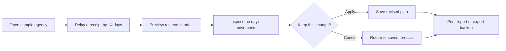
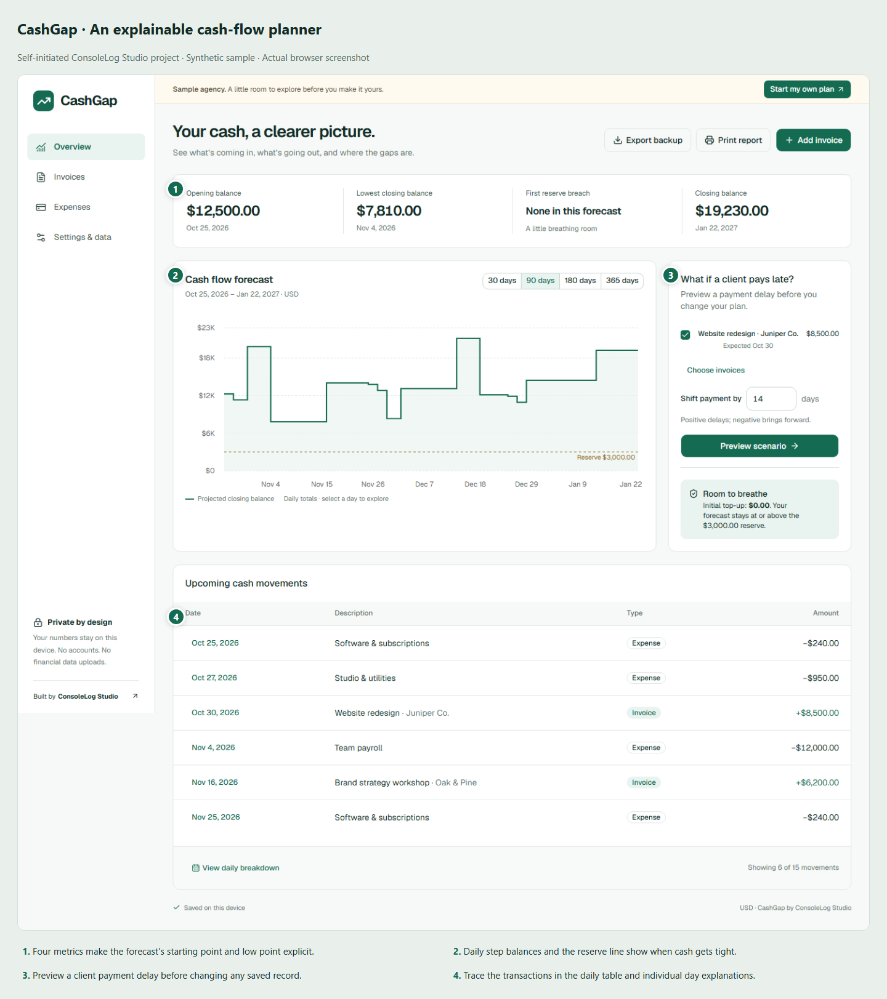
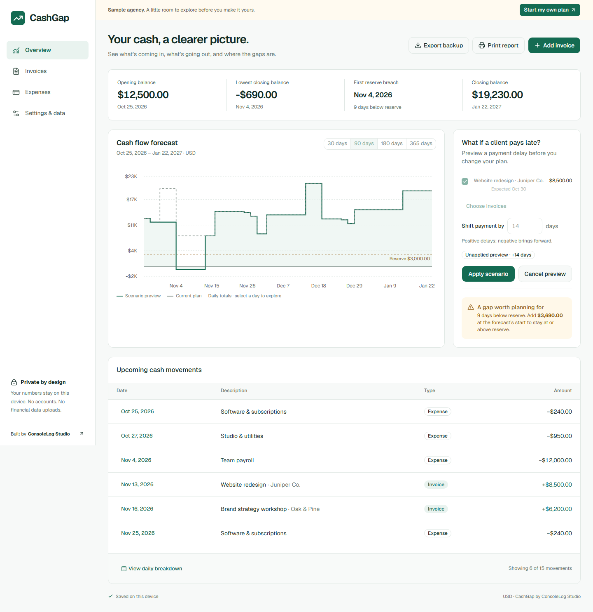
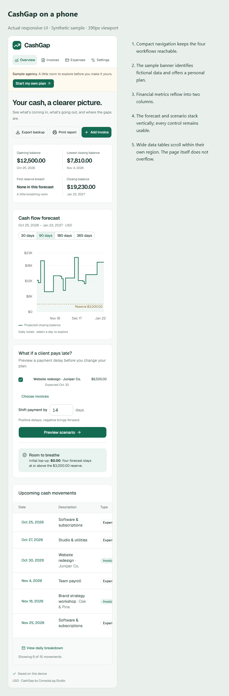

# CashGap — See the payment-timing problem before it arrives

**Self-initiated ConsoleLog Studio portfolio project · Fictional agency data · Browser-only MVP**

**Self-initiated studio project.** Built for small agency owners, with no required subscription, server, or paid API. The useful scope is one local cash-flow workspace with invoices, planned expenses, safe date experiments, and portable backups.

## The problem

An agency can have a healthy pipeline and still face a difficult payroll date. A list of project totals does not explain whether the money will arrive before contractors, software, and other commitments need paying.

CashGap makes that timing visible. The owner enters a starting balance, a reserve, expected client receipts, and planned expenses, then traces the closing balance for each day.

## The complete workflow

1. Open the sample agency and inspect its 90-day cash forecast.
2. Preview a 14-day delay to the Juniper website payment.
3. See the first below-reserve day and the required initial top-up.
4. Select a day to inspect its receipts, expenses, and balance equation.
5. Cancel the hypothetical change or apply it explicitly, then print the result or export a backup.

The sample beginning October 25, 2026 starts with $12,500 and a $3,000 reserve. Its lowest baseline closing balance is $7,810. Delaying the $8,500 Juniper receipt by two weeks lowers the minimum to −$690, making the required initial top-up $3,690. The receipt still arrives within the forecast, so the final balance is unchanged. This illustrates timing rather than a change in revenue.

These figures describe the supplied synthetic fixture. They are not measured customer savings, real business results, or a recommendation to borrow money.

## Design and engineering decisions

- **A useful demo immediately.** Synthetic records let a prospect finish a meaningful workflow without registration or sharing financial information.
- **An explainable forecast.** The chart, daily table, selected-day explanation, and printable report use the same pure calculation output.
- **Exact money and dates.** Integer minor units avoid decimal-input rounding; calendar strings avoid time-zone date shifts; monthly rules preserve their original anchor.
- **Safe experiments.** Scenario previews remain in memory. Apply checks the captured workspace revision and commits the change once.
- **Private local records.** IndexedDB transactions prevent partial imports and stale-tab overwrites. Explicit JSON backups give the owner a recovery mechanism.
- **Static delivery.** Next.js, Tailwind, and shadcn provide a polished responsive interface while all financial work remains on the visitor's device.

## Screens and annotations

1. The four metrics summarize the opening balance, earliest low point, first reserve breach, and forecast closing balance.
2. The reserve line makes risk visible within the full daily timeline.
3. The scenario panel asks one concrete business question: what changes if this client pays later?
4. Cash movements and the daily breakdown expose the transactions behind each number.
5. The sample banner and local-save status distinguish demo records from a personal plan and unsaved changes.

The dashed baseline remains visible while the preview shows the cash gap. Apply and Cancel make the difference between an experiment and a committed change explicit.

Navigation and forms adapt to a phone. Data tables scroll within their own region, and the forecast has an equivalent accessible daily table.

## Verification and boundaries

The [acceptance record](../acceptance-results.md) documents the checks actually run. The scope includes money, recurrence, receipt lifecycle, import/restore, stale tabs, storage failure, keyboard focus, accessibility checks, responsive layout, and browser-engine coverage.

CashGap models daily closing balances from user-entered assumptions. It does not connect to banks, issue invoices, predict payment likelihood, model intraday clearing, sync between devices, or provide accounting/tax advice. Browser data can be cleared; JSON backups are essential for retention.

## Portfolio use

Agency contact: [ConsoleLog Studio](https://consolelog.studio/).

The application is locally runnable. Add the verified public demo URL after the owner's deployment, and add a repository link only if the owner chooses to publish the source. Do not describe this as commissioned client work or imply that the public demo is already deployed.
